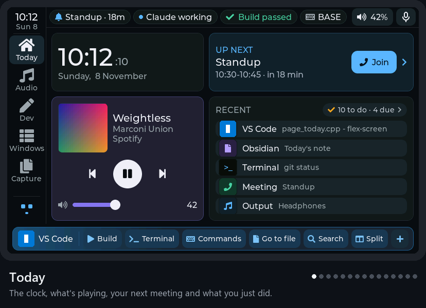

# flex-screen

<p align="center">
  
</p>

A 7" touch deck that sits beside the keyboard and handles the parts of the workday outside
the editor: audio, meetings and the calendar, tasks, Claude Code, builds, git, windows and
the clipboard. It's a Waveshare **ESP32-S3-Touch-LCD-7** (800×480, capacitive touch) on one
USB-C cable, driven by a small Windows tray app.

## Features

- **Five pages**: Today, Audio, Dev, Windows and Capture, beside a rail of page buttons and
  under a status line with the next meeting, Claude, the last build, the keyboard layer,
  the volume and the mic.
- **Claude Code**: every session on one board, with the 5-hour usage. Approve its requests
  and answer its questions with a tap, and let it ask or tell you things on the deck while
  you're away.
- **Context bar**: keys for the app or site in front: VS Code, Claude, Chrome and Edge
  (Gmail, YouTube, GitHub, Jira…), Terminal, Explorer, Obsidian, Spotify, Teams, Discord.
  Long-press a key to swap it; the shortcuts you press most are offered first.
- **Calls**: mute, camera, raise hand, reactions and leave whenever an app uses the mic,
  and Zoom's whiteboard and annotation tools.
- **Windows**: tap a window to bring it up, or drag it onto the desktop map to snap it into
  a FancyZones zone or full screen.
- **Calendar and tasks**: Google, Microsoft 365 and calendar links in one day, with **Join**
  on meetings; tasks from Google Tasks, Microsoft To Do, Obsidian, Jira and GitHub.
- **Audio, Dev and Capture**: now playing, output and input devices and a fader per app;
  recent terminal commands, git and builds; clipboard history and Obsidian notes.
- **Shortcuts and a numpad**: a launcher of up to 12 apps, links and key combos, and a real
  USB numpad with a calculator.
- **Scripts**: `flexctl notify`, `ask` and `progress` put any script's news on the deck.
- **Updates itself**: the companion updates from this repo's releases and brings the deck
  its new firmware over USB.
- Five color themes, a keyboard-layer cheat sheet, a demo and diagnostics.

Every feature in detail: [docs/features.md](docs/features.md).

## How it fits together

```
ESP32-S3 deck ──USB (serial + keyboard)──► Companion (Windows tray app, C#)
                                              ▲            ▲            ▲
                         VS Code extension ───┘            │            └─── Browser extension (optional)
                                                 Claude Code hooks
```

- **Firmware** (`firmware/`, PlatformIO, Arduino-ESP32 + LVGL 9) draws the UI. The deck is
  also a USB keyboard, so the numpad and media keys work even without the companion.
- **Companion** (`companion/`, .NET 10) does everything that needs Windows, Google or the
  filesystem, and runs the deck's actions.
- **VS Code extension** (`vscode-ext/`) reports terminal commands, tasks and the workspace.
- **Claude Code hooks** report when a Claude session is working, needs you or is done.
- **Browser extension** (`chrome-ext/`, optional) tells the companion which site is in front.

## Setup

### Install
Download `flex-screen.zip` from the
[latest release](https://github.com/AsafDov/flex-screen/releases/latest), unzip it, run
`install.cmd` and plug in the deck. No admin rights or .NET needed. It installs the
companion (started at sign-in), the VS Code extension, the Claude Code hooks and `flexctl`;
`uninstall.cmd` removes them. The companion offers the deck its firmware, and keeps both up
to date.

Optional, each with its own guide:
- Google Calendar and Tasks: [docs/google-setup.md](docs/google-setup.md)
- Microsoft 365 and other calendars, and what to hide: [docs/calendars.md](docs/calendars.md)
- Microsoft To Do, Obsidian, Jira and GitHub tasks: [docs/task-sources.md](docs/task-sources.md)
- The browser extension, Teams calls and VS Code Remote-SSH: [install/README.txt](install/README.txt)

### Firmware
The companion keeps the deck's firmware up to date. To build and flash it yourself you need
PlatformIO (run it from PowerShell). The first build downloads ESP-IDF's toolchain into
`~/.platformio-deck` and takes about 25 minutes, later ones a few. From the repo root:

```powershell
pio run -d firmware -t upload                     # a deck already running flex-screen
pio run -d firmware -e deck-esptool -t upload     # first flash, or a deck that won't start
```

The second one goes through the UART port and the ROM bootloader: hold BOOT, tap RESET, let
go of BOOT, and tap RESET again after flashing. `backup/` holds the board's factory firmware
and how to restore it.

### Profiles
Your settings live in a **profile**: the accounts, which calendars and task lists show,
the shortcuts, the context bar's keys and your own sites. Keep several (work and home) and
switch from the tray icon; put them in a synced folder to share them between PCs. Sign-ins
stay on each PC, and each PC's own settings are in `machine.json`.
See [docs/settings.md](docs/settings.md#profiles).

### Settings
Tray icon → **Profile → Open profile file**. Saved changes apply straight away, and editors
like VS Code complete and check it. Every setting is in
[docs/settings.md](docs/settings.md#settings).

### Building the kit
```powershell
powershell -ExecutionPolicy Bypass -File install\build-dist.ps1   # -> dist\flex-screen.zip
```

For a release, tag it `v` plus the firmware's version (`firmware/src/pc.h`) and attach
`dist\flex-screen.zip`: installed companions update from it. `-Version 1.2.1` builds a
PC-only release; it has to match the tag.

The deck's UI also runs on the PC, with tests that tap through every feature:
[simulator/README.md](simulator/README.md).

## Repository

| Folder | What's in it |
|---|---|
| `firmware/` | The deck: pages, tiles, touch, the USB link |
| `companion/` | The Windows tray app; each app's keys and call controls in `companion/Integrations/<App>/` |
| `vscode-ext/` | The VS Code extension |
| `chrome-ext/` | The browser extension (Chrome and Edge) |
| `protocol/` | [v0.md](protocol/v0.md): every message between the parts |
| `install/` | The kit builder, install scripts and `flexctl` |
| `docs/` | [Features](docs/features.md), [settings](docs/settings.md), the setup guides and [making a tile](docs/making-a-tile.md) |
| `simulator/` | The deck's UI on the PC, with feature tests and screenshots |
| `backup/` | The board's factory firmware |

[DESIGN.md](DESIGN.md) has the architecture, the history and the decisions behind each
feature.

## Making your own tile

Every page is made of tiles: each card is a module in `firmware/src/tiles/`, a page is a
list of their ids in `pages.cpp`, and the deck lays them out on a 14 x 12 grid and resizes
them for you. A new tile is one file and two one-line changes: write the tile, register it
in `tiles.cpp`, and add its id to a page. The [tile guide](docs/making-a-tile.md) walks
through a complete example.
