# flex-screen

A 7" touch deck that sits next to the keyboard and runs the parts of the workday that live
outside the editor: audio, meetings, Claude Code, builds, git, windows, clipboard, Obsidian
and a numpad.

It's a Waveshare **ESP32-S3-Touch-LCD-7** (800×480, capacitive touch) on one USB-C cable,
talking to a small Windows tray app. Six swipe pages sit under one status bar.

```
ESP32-S3 deck ──USB (serial + keyboard)──► Companion (Windows tray app, C#)
                                              ▲            ▲
                         VS Code extension ───┘            └─── Claude Code hooks
```

- **Firmware** (`firmware/`, PlatformIO, Arduino-ESP32 + LVGL 9) draws the UI. The deck is
  also a real USB keyboard and media-key device, so the numpad and play/pause work even
  without the companion.
- **Companion** (`companion/`, .NET 10) does everything that needs Windows, Google or the
  filesystem, pushes state to the deck and runs its actions.
- **VS Code extension** (`vscode-ext/`, TypeScript) reports terminal commands, tasks and the
  active workspace.
- **Claude Code hooks** tell the companion when a Claude session is working, needs you or
  is done.

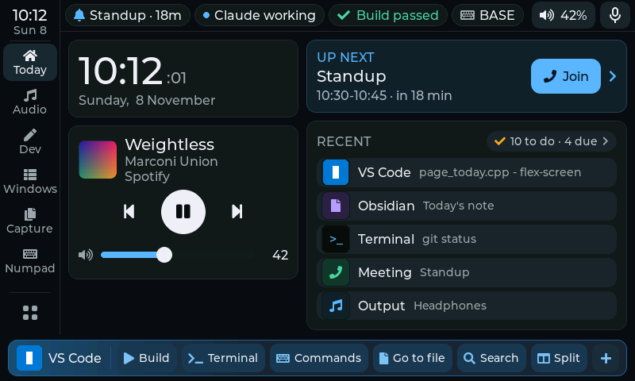

## Features

### Status bar (on every page)
- Clock and date.
- Next meeting with a countdown, amber from five minutes out.
- Claude Code status (working, needs you, done); tap it for the session board.
- Last build result.
- Keyboard layer (from a Vial keyboard); tap it to pin the layer cheat sheet open.
- Volume (tap to mute) and microphone mute, which mutes every mic so Teams, Zoom and
  Discord all go quiet at once.
- Toasts over any page: a long command finished or failed, Claude needs approval, git
  results.

### Claude session board (from the status bar)

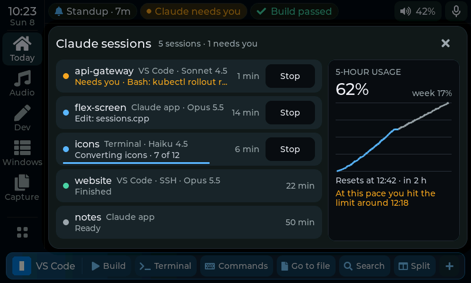

- Every Claude session on the PC in one list: the Claude app, each VS Code window,
  terminals and Remote-SSH. The ones that need you first, then those at work, then the
  rest. Each row says where it runs and its model, what it's doing (or waiting on), how
  long it's been at it, and a long job's progress.
- Tap a row to bring up its window. **Stop**, held, ends that session's turn before its
  next step (a tap only says *Hold*). It works the same in the app, VS Code, a terminal or
  on a server: before each tool call Claude checks with the companion, about 70 ms.
- Beside it, the plan's 5-hour usage: the figure, the week's, a chart of the window so far
  with the recent pace carried ahead, when it resets, and "At this pace you hit the limit
  around 21:40" (or that it lasts until the reset).
- The status bar's Claude pill and the Dev page's Claude banner open it.

### Claude approvals (on every page)

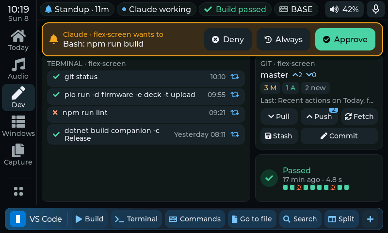

- When Claude Code asks for permission (in the Claude app, VS Code or a terminal), a banner
  under the status bar shows what it wants to run, with **Approve**, **Always** (Claude's
  own "don't ask again" rule, when it offers one) and **Deny**. Claude's prompt on the PC
  shows as usual; whichever you answer first wins.
- Claude's own questions (its question box) show on the deck with their options: tap one,
  or for a question that takes several, tap them and **Done**. Several questions asked
  together come one at a time ("2 of 3"). The X leaves it to the PC. Again, whichever you
  answer first wins.
- Turn both off from the tray icon: **Approve Claude from the deck**.
- The status bar's Claude pill says **needs you** for a question too, and a plan waiting
  for approval or a turn that ends asking you something in the Claude app (those you
  answer at the PC). A banner or card goes as soon as you answer at the PC instead.

### Claude talks to the deck (on every page)

<p>
  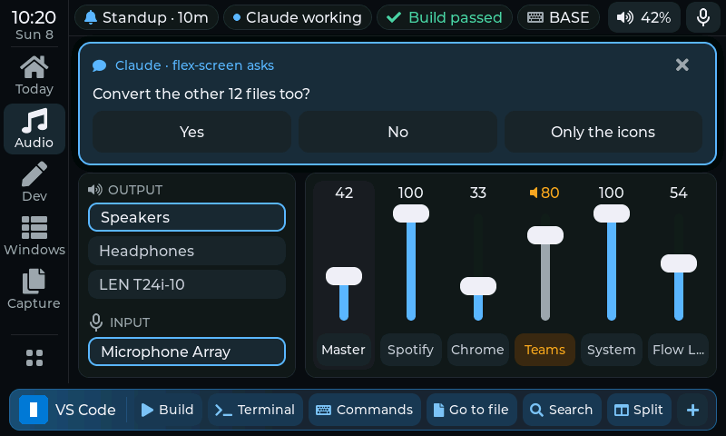
  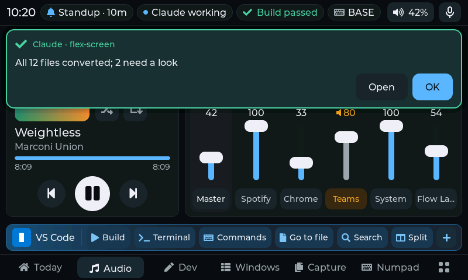
</p>

- Claude Code gets three tools for the deck (an MCP server in the companion, registered
  for every project when the hooks are installed, and allowed without a prompt):
  - **deck_ask**: a question with 2-4 buttons; Claude waits for your tap (up to 15
    minutes, or as long as it asks, at most 50) and carries on with the answer. Handy for
    long jobs you leave running: ask it to "ask me on the deck" before anything risky.
  - **deck_notify**: a note that stays until you tap **OK** (or write to that session
    again); **Open** brings up its window.
  - **deck_progress**: "3 of 12 · Converting icons" on the Dev page's Claude banner, with
    a bar, and **Claude 3/12** in the status bar, until the job or the turn ends.
- Claude decides when to use them; it's told they're for when you may be away from the
  keyboard, not for the ordinary chat. Sessions on a Remote-SSH server get them through
  the same tunnel as the hooks.

### Context bar (on every page but the Numpad)

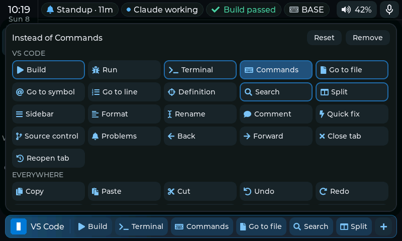

- A strip above the tabs with keys for the app in front on the PC, in that app's color. The
  keys each app starts with (a long press shows the rest of its list):
  - **VS Code:** Go to file, Go to symbol, Terminal, Search, Approve, Model. Its list also
    has Build, Debug and stepping, Definition, Rename, Format, Comment, Quick fix, Source
    control, and Claude's own: open Claude, New Claude chat, Accept or Reject changes,
    Mention file.
  - **Claude Code in VS Code:** while Claude's chat tab is the one in front, the bar turns
    into Claude's, in Claude's color: Approve, Deny, Model, Effort, Usage, New chat (its
    list also has Stop, Another chat, Reopen chat and VS Code's keys). This needs Claude in
    an editor tab (Claude's "Open in New Tab", its default), not the side bar, which VS Code
    doesn't let the deck's extension see. Local and Remote-SSH windows alike.
  - **Claude app:** Approve, Deny, Model, Effort, Usage, New chat.
  - **Chrome and Edge:** Back, Reload, Prev tab, Next tab, New tab, Reopen, Find. On
    **Gmail**, **YouTube**, **Google Calendar**, **Jira** and **GitHub** the bar has that
    site's keys (Compose, Reply, Archive…; Play, Back 10 s, Captions…; Today, Week, New
    event…; Create, Comment, Assign to me…; Issues, Pull requests, Find file…), and on your
    own sites the keys you give them (see [Sites](#sites-in-the-browser)). Gmail's need its
    keyboard shortcuts turned on in Gmail's settings.
  - **Installed web apps** (Chrome's or Edge's *Install as app*: Gmail, Outlook, YouTube
    Music…) show on the deck under their own name and icon, and get their site's keys.
  - **Windows Terminal:** Prev cmd, New tab, Prev tab, Next tab, Split right, Split down;
    its list also has Clear, History, keys that type `git status`, `git pull` or `claude`,
    and Claude's keys.
  - **Explorer:** Up, New folder, Rename, Copy path, **Terminal here**, **VS Code here** (and
    Claude here, Copy folder, Preview pane, views…).
  - **Obsidian:** Daily note, Search, Quick open, Commands, Back, Graph.
  - **Spotify:** Previous, Play/pause, Next, Like, Shuffle, Search.
  - **Teams:** Activity, Chat, Calendar, New chat, Search; during a meeting Mute, Camera,
    Raise hand, Like, Share, Leave (and the other reactions).
  - **Discord:** Switch, Prev channel, Next channel, Unread, Mute, Deafen.
  - **Any other app:** Copy, Paste, Undo, Save, Find, Close, in the color of its icon.
- A key presses its shortcut in that app's window. If the desktop or a menu took the front
  meanwhile, the window comes back first. In VS Code, keys run VS Code's own commands
  through the flex-screen extension, so your own keybindings don't matter.
- **Claude's keys** work wherever Claude Code runs, the app, VS Code or a terminal:
  **Approve** and **Deny** answer the newest request; **Model** and **Effort** show the
  session's (the model from Claude's last reply in the session) and open a list to change
  them (typed as `/model` or `/effort` into its prompt); **Usage** shows the 5-hour
  window's use ("5h 42%") and types `/usage` there. The percentage comes from the usage
  endpoint `/usage` itself reads, with the sign-in token Claude Code keeps in
  `%USERPROFILE%\.claude\.credentials.json`. When that token has expired (the Claude app
  signs in on its own and leaves the file alone), the companion runs Claude Code's own
  `claude -p /usage` in the background, at most every 20 minutes, which reads the figure
  and renews the token. That renewal only works while Claude Code's sign-in lasts; when
  it ends the key says **Sign in**, and tapping it opens `claude auth login` in a console
  window (it goes on in the browser); the figure comes back within a couple of minutes.
  The Claude app's own sign-in is separate and can't be read. For Claude Code on a
  Remote-SSH server, the server's hooks run its `/usage` there and send the figure (see
  VS Code Remote-SSH below).
- **Long-press a key** to pick another action for its place from that app's list (VS Code
  also has Go to symbol, Go to line, Run, Rename, Format, Comment, Source control…; every
  app gets an "Everywhere" list: Snap left, Screenshot, Lock PC…). One already on the bar
  swaps places with it, which is how you reorder. **Remove** takes the key off, **Reset**
  puts the app's defaults back, and **+** at the end adds a key. Each app's arrangement is
  kept by the companion on that PC.
- Add your own actions to an app's list in the profile's `contextBar` (see [Settings](#settings)).

### Sites in the browser
Which site a browser window shows is told by its tab's title (*… - Gmail*, *… · GitHub*),
or, with the **flex-screen browser extension**, by its address, which works on every page
whatever its title says (a Jira issue, a GitHub file). The extension comes with the
companion: once per browser, open `chrome://extensions` (or `edge://extensions`), turn on
**Developer mode**, **Load unpacked**, and pick
`%LOCALAPPDATA%\Programs\flex-screen\chrome-ext`. It sends the companion only the address
and title of the tab in front, to `localhost`, never for an incognito tab; the companion
keeps them in memory and tells the deck only which site it is. Updates come with the
companion's, picked up when the browser restarts.

A site's keys are data: the built-in ones are
[companion/Integrations/Browser/sites.json](companion/Integrations/Browser/sites.json), and
the profile's `"sites"` add your own (or replace a built-in one by its id). A key is written
as for `contextBar`:

```jsonc
"sites": [
  { "id": "notion", "name": "Notion", "color": "#FFFFFF",
    "match": { "url": ["www.notion.so/*"], "title": ["* | Notion"], "app": ["Notion"] },  // * is anything
    "keys": [
      { "id": "notion-search", "name": "Search", "glyph": "search", "keys": "Ctrl+P" },
      { "name": "New page", "glyph": "plus", "keys": "Ctrl+N" }
    ],
    "default": ["notion-search"] }   // the bar until you arrange it on the deck
]
```

`url` is the address without `https://` (host and path), `title` the tab's title, `app` an
installed web app's name. The address is tried first, then the app, then the title, and
the first site that matches wins (yours before the built-in ones).

### Panels
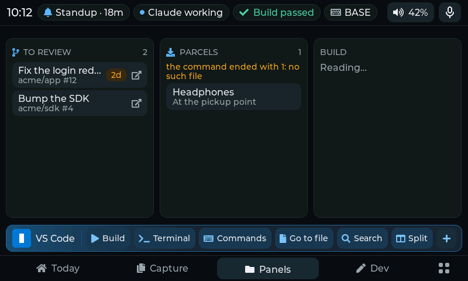

Lists of your own on a page of their own, without a new companion or firmware: pull
requests to review, parcels on their way, a build's status, today's notes, anything a web
address or a script can give. Up to 4, each with up to 12 rows; a row can have a second
line, a badge, and an address a tap opens on the PC. The page is on the deck only when
there are panels (before the Numpad, unless the profile's `pages` say otherwise).

```jsonc
"panels": [
  { "id": "notes", "name": "Notes", "glyph": "pen", "url": "http://localhost:8000/notes.txt" },
  { "id": "reviews", "name": "To review", "glyph": "branch", "url": "https://example.com/reviews.json", "every": 300 }
]
```

- `url`: read every `every` seconds (5 minutes unless set, 30 at the least): JSON, or plain
  text with a row per line.
- `command`, instead of `url`: run on this PC (through `cmd`, from your user folder, 30 s
  at most), its output read the same way. A command runs code, so it's only taken from this
  PC's `machine.json`, never from a profile (which can come from a synced folder). Its
  panels join the profile's.
- What they give: a list of rows, or `{ "rows": [...], "note": "as of 10:00" }`; a row is a
  line of text or `{ "text", "sub", "badge", "open": "https://…" }`. A panel that can't be
  read says why and keeps its last rows.
- `glyph`: an icon of the deck's font (the list is in `firmware/scripts/gen_font_icons.py`).

### Pages
The profile's `pages` says which pages the deck shows and in what order:
`"pages": ["today", "capture", "dev", "windows", "panels"]` (from `today`, `audio`, `dev`,
`windows`, `capture`, `numpad`, `panels`). Without it, the six as they've always been, and
Panels when there are panels. The deck restarts into another order, as it does for other
colors.

### Shortcuts (on every page)

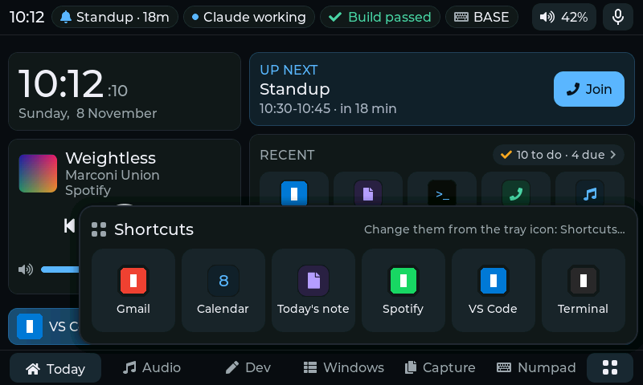

- A launcher button at the right end of the tab bar opens a panel of up to 12 tiles:
  apps, links, deck actions and key combinations, each with its real icon (an app's own,
  a site's) or a symbol. Tap one to run it; tap anywhere else to close.
- An app that's already open comes to the front instead of starting again. Apps are
  found by their Start menu name, Store apps (Spotify, Terminal) included.
- Out of the box: Gmail, Calendar, Today's note, Spotify, VS Code and Terminal. Change
  them per PC from the tray icon's **Shortcuts…** (see [Settings](#settings)).

### Today
- Big clock.
- Now playing: album art, title, artist and app, play/pause, next/previous, volume.
- Up next: the next calendar event with a **Join** button for Meet, Zoom or Teams links.
  Tap it for the whole day: today's events in order, those over dimmed above a line at
  the time now, the one going on picked out, **Join** on each with a meeting link, which
  calendar each is from, today's all-day events along the top, and tomorrow's below.
  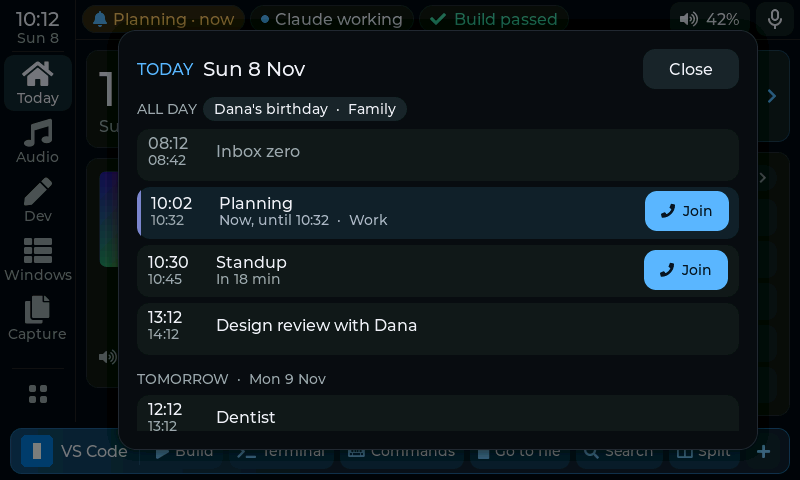
- Recent: the last five things you did from the deck, as tiles: a window you brought up
  (with its app icon), a note opened, a command run, a meeting joined, Gmail, a Claude
  session, a sound output picked. Tap one to do it again; a window that has closed since
  brings up another window of its app, or starts the app. Most recent on the left; doing
  something already listed moves it there instead of adding it twice.
- How many tasks are open and how many are due today or overdue; tap it for Capture.

### Audio

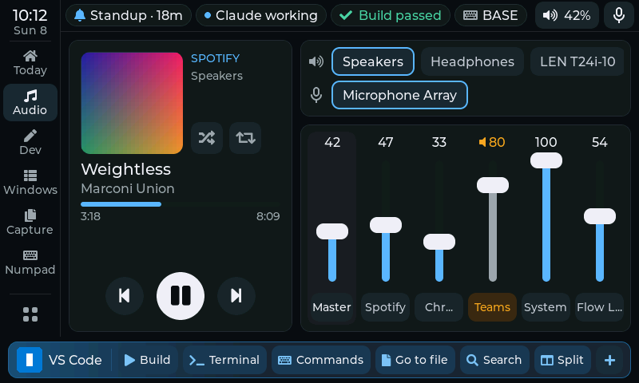

- Now playing with large art, progress, shuffle and repeat.
- Output and input device pickers that set the Windows default device.
- Per-app mixer: a fader for each app playing sound; tap the app's name under it to mute
  it (amber while muted).

### Dev

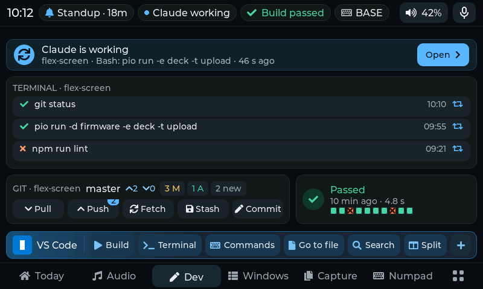

- Claude banner: what the current session is doing, with an **Open** button; tap the
  banner for the session board.
- Git for VS Code's active repo: branch, ahead/behind, changed files; fetch, pull, push,
  stash, and **Commit…** to open VS Code's Source Control.
- Build card: the last 10 build runs and their results.
- Terminal: the last few commands run in VS Code's terminal, each in full (a long one
  wraps), with ✓/✕ and the time it started. Tap one to run it again in the terminal it
  came from. History is kept per workspace, so it survives restarts.

### Windows

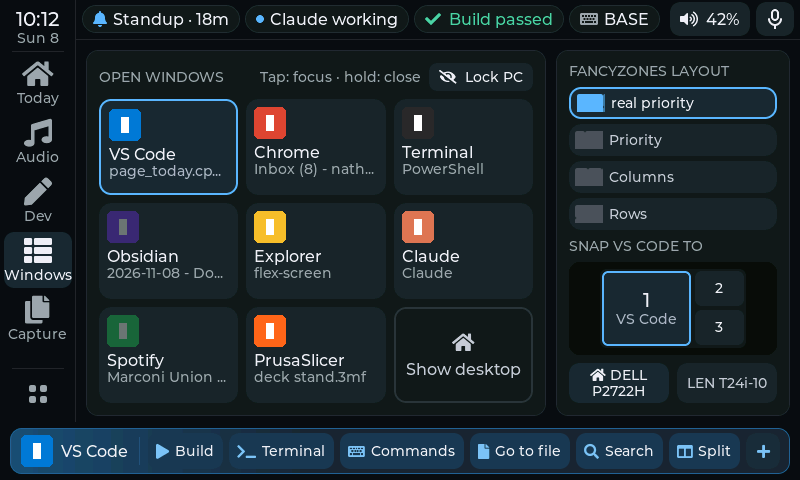

- The 8 most recently used windows with their icons, in taskbar order. Tap to focus (tap
  again to minimize); a minimized window keeps its tile, icon dimmed, and a tap brings it
  back. Hold to close the window, which takes its tile away at once.
- Show desktop and Lock PC.
- FancyZones: switch each monitor's layout (Priority grid, Columns, Rows, Grid or your
  custom layouts), tap a zone on the map to snap the active window into it, tap it again
  to maximize. A monitor picker for multi-monitor setups.

### Capture

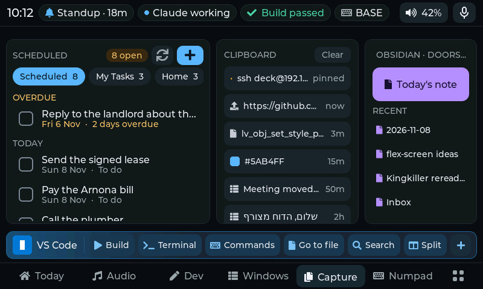

- Tasks (see below), the clipboard and Obsidian side by side.
- Clipboard history: your newest text copies plus pins. Tap to paste into the focused
  window, hold to pin, Clear. Copies that password managers mark as private are never
  recorded, and the history is stored encrypted for your Windows account.
- Obsidian: open today's daily note, or one of the five most recent notes.

### Tasks (on Capture)

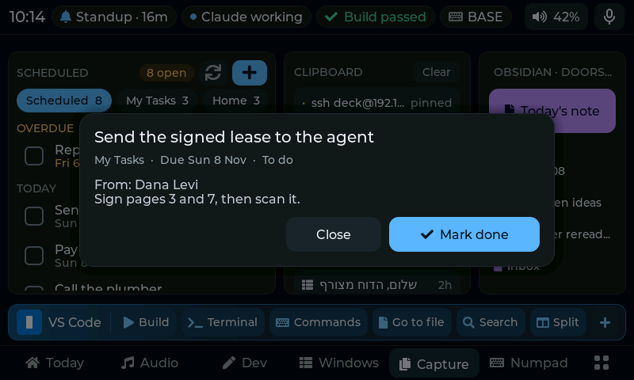

- Tasks from several places at once, each keeping where it came from: **Google Tasks**,
  **Microsoft To Do**, the open tasks of your latest **Obsidian** daily note, and the
  **Jira** and **GitHub** issues assigned to you (set up under the tray icon's **Task
  sources**; [docs/task-sources.md](docs/task-sources.md) walks through each). A source not
  set up on a PC is left out, so the same companion suits home and work.
- Chips along the top with how many are open in each: **All tasks** (where it opens: every
  task of the lists you chose for the deck, dated ones first), **Scheduled** (every task
  with a due date, from any list, also one kept off the deck) and then each list you chose
  (the tray icon's **Task lists on the deck**; all of them until you untick some). Swipe
  the chips sideways for the ones past the card's edge. Grouped by when they're due:
  overdue, today, tomorrow, this week, later, no date. Under Scheduled a row is just the
  title, the due day and its status (to do, done, or how many days overdue); in a list it's
  the day and the first line of its notes, and under All tasks the list's name first. An
  issue's row shows its key, priority and status instead. Subtasks are indented.
- Tap a task to open it: its whole title, list, due day, status and notes, what its source
  says about it (a Jira issue's project, key, priority and status, below), **Open in …** (the
  issue's page, the note in Obsidian, the task on the web), **Mark done** and **Close**
  (or tap beside it).
  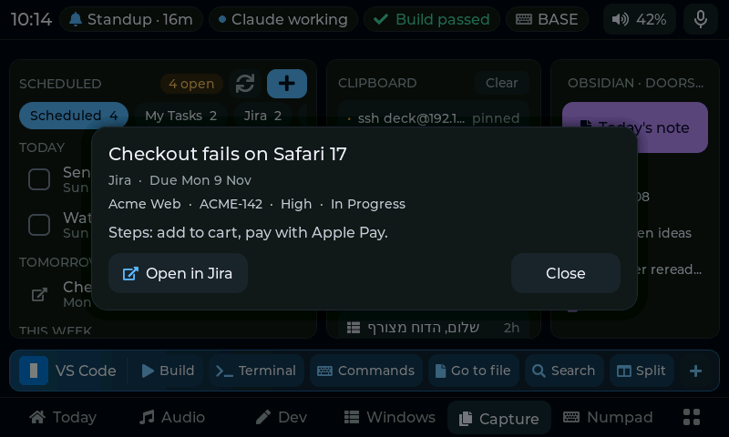
- Tap the box at a task's start to tick it off in its source straight away. It stays on
  the page, struck through, until midnight, so ticking it again undoes it. Jira and GitHub
  issues have no box: they're moved on in Jira or GitHub, not by a slip of the finger.
- **+** opens a form with an on-screen keyboard: the title, which list (the one on
  show to begin with; from All tasks, Scheduled or an issues list, the first list, due
  today from Scheduled) and when it's due (no date, today or tomorrow).
- No *Starred*: Google's Tasks API doesn't say which tasks are starred.
- The ↻ button reads every source again now; otherwise the companion reads them every 2
  minutes and right after every change from the deck.
- Another source is one class in the companion (`ITaskProvider`: read, tick, add), added
  to the list in `TrayApp`.

### Numpad

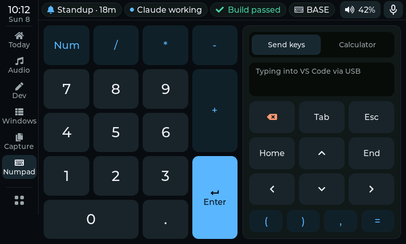

- A full USB keypad, with keys that repeat while held, editing keys, and `( ) , =`.
  Num Lock follows the PC's.
- Calculator mode: work it out on the deck, and Enter types the result into the PC.

### Calls

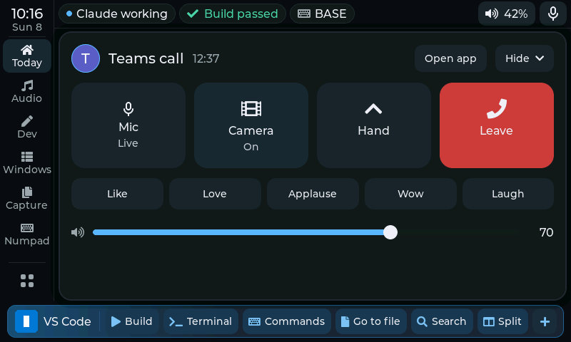

<p>
  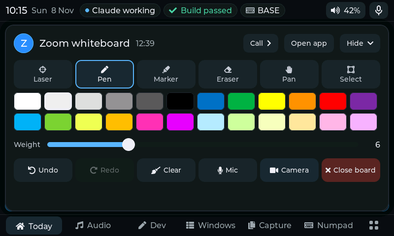
  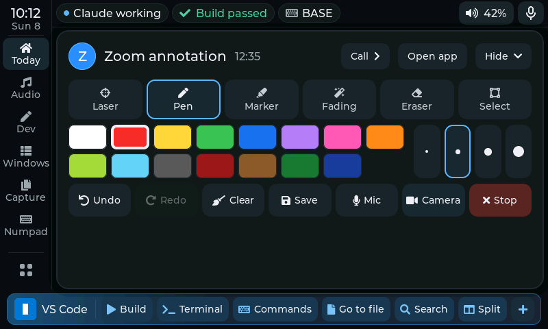
</p>

- When an app is using the microphone (Teams, Zoom, Discord, Webex, a browser), a call
  panel pops up with what that app allows: mute, camera, raise hand, reactions, leave,
  volume, and bring the call forward. Hide turns it into a status-bar pill.
- Teams through its local API (real mute, camera and hand state); Zoom through its own
  toolbar buttons (real mute and camera state, even while sharing); Discord's deafen
  through the mixer. A Zoom meeting counts as a call even when joined without audio.
- Zoom drawing: **Whiteboard** opens a new whiteboard, **Annotate** starts annotating the
  screen you're sharing. While either is open the panel turns into a tool panel:
  - Whiteboard: Laser, Pen, Marker, Eraser, Pan, Select. Each tool shows its own colors
    (the pen's 24, the marker's 6, the laser's 6) and the pen, marker and pixel eraser a
    weight slider; the eraser switches between whole stroke and pixel. Zoom hides the
    laser when the meeting window is narrow, and so does the deck.
  - Annotation: Laser (Zoom's spotlight, or its arrow), Pen, Marker, Fading pen, Eraser,
    Select, with Zoom's 15 colors and four line widths.
  - Both: Undo, Redo, Clear (hold), Save (annotation), Mic, Camera and Stop/Close.
    "Call" in its corner flips back to the call's controls and "Draw" returns.
- Meeting apps' context bar (Zoom, Teams, Discord): that app's next meeting on your
  calendar, told by its link (a zoom.us link for Zoom, a Teams link for Teams, a Discord
  invite or event for Discord; "12m · Standup", tap for Today's Up next), Join (that
  one), Mute and
  Camera (showing the call's state; Mute is Windows' mic outside a call), New meeting
  (Zoom's instant meeting, Teams' new-meeting form, Discord's Start call in the open DM)
  and Chat (Zoom's Team Chat, Teams' Chat; the meeting's chat during one). In a meeting
  Share and Leave join them. Discord has no camera key (Discord has no shortcut for it)
  and keeps Deafen. Zoom's bank also holds Participants, Reactions, Whiteboard, Annotate,
  Raise hand, Record, Full screen and quick reactions (hold a key to swap).

### Keyboard layer cheat sheet

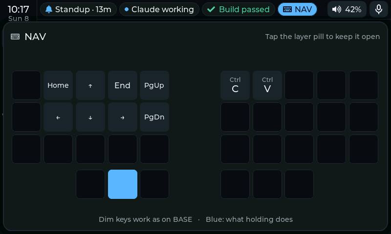

- Hold a layer key for ten seconds (`cheatSheetSeconds` in [Settings](#settings)) and the
  deck shows that layer laid out like your keyboard, read straight from the Vial keyboard's own layout and keymap. Letting go
  hides it; tapping the layer pill keeps it open.
- With more than one Vial keyboard plugged in, the pill and cheat sheet follow the one
  you last typed on. A keyboard Vial has locked can't report its layer: unlock it once
  in the Vial app (Security > Unlock) and it stays unlocked until it's unplugged.

### The deck itself
- Idle: a dim clock after 10 minutes without input on the deck or the PC, screen off
  after 30 (both adjustable). A locked PC shows the clock straight away.
- Four color themes, Base, Vibrant, Ember (warm, orange) and Violet, from the tray menu.
- One deck, several PCs: it shows whichever PC it's plugged into. Each PC's companion
  keeps its own settings, Google sign-in, vault and clipboard.

### Updates

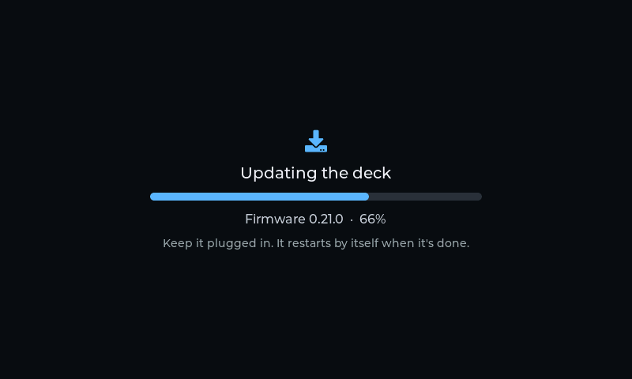

- **The deck's firmware comes with the companion.** When the deck runs an older one (it
  was last updated on another PC, say), the tray icon says so and the deck shows
  "Firmware 0.21.0 is ready · tap to update". Tap it, or pick **Update the deck's
  firmware** in the tray menu. It goes over the same USB cable in about half a minute,
  with the progress on the deck. No PlatformIO needed, so any PC with the companion can
  do it.
- Nothing changes on the deck until the whole image has arrived and checked out (its MD5,
  checksum and SHA-256); an update that stops on the way (unplugged, the PC asleep) leaves
  the deck on the firmware it had. A new firmware also stays on trial until it has heard
  from the PC: one that can't start, or can't reach the PC, is undone by the next restart
  (unplug the deck and plug it back in). If the deck doesn't come back at all, the tray
  says how to flash it through its bootloader (see [Firmware](#firmware)).
- **The companion updates itself** from this repo's GitHub releases. It looks a minute
  after it starts and every 6 hours (**Check for updates** in the tray menu looks now).
  When there's a newer release, **Update flex-screen to 0.21.0** downloads the release's
  `flex-screen.zip`, checks it against the SHA-256 GitHub gives for it, and installs it as
  `install.cmd` does (the companion, the VS Code extension and the hooks). The companion
  restarts by itself, says it's updated, and then offers the deck its new firmware.
- The deck running newer firmware than the companion knows (it came from a PC with a newer
  kit) makes the companion look for an update straight away.

## Setup

### Firmware
Once the companion is installed, it keeps the deck's firmware up to date by itself (see
[Updates](#updates)). Building and flashing it yourself needs PlatformIO (run it from
PowerShell, not Git Bash). From the repo root:

```powershell
pio run -d firmware -t upload
```

This updates a deck that already runs flex-screen over its own USB link. For the very
first flash, or a deck that doesn't start or connect any more, use the UART port and the
ROM bootloader (hold BOOT, tap RESET, let go of BOOT; tap RESET again after flashing):

```powershell
pio run -d firmware -e deck-esptool -t upload
```

`backup/` holds the board's factory firmware and how to restore it.

### Companion, extension and hooks
To build an install kit for any Windows PC (no admin rights or .NET needed there):

```powershell
powershell -ExecutionPolicy Bypass -File install\build-dist.ps1
```

Unzip `dist\flex-screen.zip` on the PC and run `install.cmd`. It installs the companion
(started at sign-in), the VS Code extension and the Claude Code hooks; `uninstall.cmd`
removes them. The kit also carries the deck's firmware (it builds it with PlatformIO).

For a release, tag it `v` plus the version (`v0.21.0`) and attach `dist\flex-screen.zip`
to it: installed companions find it there. The kit's version is the firmware's
(`firmware/src/pc.h`) unless you give another, for a release that only changes the PC
side: `build-dist.ps1 -Version 0.21.1`. It has to match the tag, or the companion refuses
the update. [install/README.txt](install/README.txt) covers the optional parts: Google
Calendar and Tasks, Teams calls and per-PC settings.

### Google Calendar and Tasks
[docs/google-setup.md](docs/google-setup.md) walks through it: your own Google sign-in app
(once), connecting each PC from the tray, more than one Google account, and troubleshooting.

### Calendars
The deck's calendar can come from several places at once, merged (a meeting on two of them
shows once): Google accounts, **Microsoft 365 or Outlook.com** accounts, and **calendar
links** (an iCalendar address: a published Outlook calendar, Google's or iCloud's secret
address, a school's or a team's). The tray icon's **Calendars** menu lists them, with each
one's calendars to tick for the deck, and adds more. It also hides events: those you
declined (on by default), all-day ones, those marked free, or those whose title has a word
you give (Lunch, Focus time). [docs/calendars.md](docs/calendars.md) has the details.

### VS Code Remote-SSH
Working on a Linux server from the deck's PC: the extension runs on the PC even in a
Remote-SSH window (keep it installed there), so terminal commands reach the deck as
they are. For Claude Code running on the server, add `RemoteForward 48151 localhost:48151`
under the server's Host in the PC's `~/.ssh/config`, reconnect, and run
`install/remote-claude-hooks.sh` on the server once (again after an update that changes
it: 0.16.2's sends the model of Claude's last reply, for the Model key; 0.16.3's also
runs Claude Code's own `/usage` there after each turn, at most every 3 minutes, for the
Usage key; 0.19.0's registers the deck's tools with Claude Code there; 0.20.0's adds the
board's Stop). A session there is
matched to the VS Code window that has its folder open.
Details in
[install/README.txt](install/README.txt).

### Simulator
The deck's UI also runs on the PC, in a window or headless, driven over a local port with
made-up data: `simulator\build.ps1` builds it (needs Visual Studio's C++ build tools), and
`simulator\test_deck.py` taps through every feature. See [simulator/README.md](simulator/README.md).

### Profiles
Your settings live in a **profile**: its Google accounts and task sources, shortcuts,
context bar keys, colors and the rest. Keep one, or several to switch between (work and
home, say): tray icon → **Profile: …** lists them, and **New profile…** starts one as a copy
of the current one or from the defaults. The deck says *Profile: work* when it switches,
and reads the calendar and the tasks again at once.

- **Profiles are files**, `%LOCALAPPDATA%\flex-screen\profiles\<name>.json`. **Keep the
  profiles in…** moves them to another folder: a synced one (OneDrive, Dropbox, a git repo)
  gives every PC the same profiles. Pick the same folder on each PC.
- **Sign-ins stay on each PC.** A profile names the accounts and sites; each PC signs in to
  each one once, and keeps the tokens encrypted for its Windows user, one per account or site.
  A profile can go anywhere: there's nothing secret in it.
- **This PC's own settings** are in `%LOCALAPPDATA%\flex-screen\machine.json` (tray icon →
  Profile → **Open this PC's settings**): the profile it uses, where the profiles are, and
  the Obsidian vault's folder. Any profile setting written there wins on this PC only, so
  one profile can still differ per PC: `"jira": null` turns the profile's Jira off here, a
  `"shortcuts"` list of its own gives this PC other tiles.

```jsonc
// machine.json
{
  "profile": "work",                                   // profiles\work.json; "default" when not set
  "profilesFolder": "C:\\Users\\me\\OneDrive\\flex-screen",  // else %LOCALAPPDATA%\flex-screen\profiles
  "obsidianVault": "C:\\path\\to\\vault"                // Task sources › Obsidian daily note picks it; else the open vault
}
```

The `settings.json` from before profiles becomes the `default` profile (and the vault goes
to `machine.json`) the first time the companion starts; the old file stays beside it as
`settings.json.before-profiles`.

### Settings
Optional, in the profile. The tray icon's **Profile → Open profile file** opens it, with the
everyday settings it doesn't have yet (colors, idle times, layer names, cheat sheet time)
written in at their current values. Saved changes apply straight away. Its `"$schema"` line
gives editors that read it (VS Code) completion and checks for everything here
([companion/profile.schema.json](companion/profile.schema.json)).

```jsonc
{
  "palette": "base",                                   // or "vibrant", "ember", "violet"
  "idle": { "clockAfterMinutes": 10, "screenOffAfterMinutes": 30 },  // 0 turns either off
  "layerNames": ["BASE", "NAV", "SYMBOL"],             // your keyboard's layers
  "cheatSheetSeconds": 10,                             // hold a layer key this long for its cheat sheet; 0: only from the pill
  "accounts": {                                        // by id (the tray's Google accounts and Calendars); without it, one: "google"
    "google": { "type": "google", "label": "Personal", "calendars": { "hide": ["Birthdays"] } },
    "google-work": { "type": "google", "label": "Work", "client": "google-client-work.json", "tasks": false },
    "microsoft-work": { "type": "microsoft", "label": "Work", "clientId": "…", "tenant": "organizations" },
    "ics-school": { "type": "ics", "label": "School" }        // its link is kept on each PC; a public one can be "url" here
  },
  "calendarFilter": { "hideTitles": ["Lunch", "/^Focus/"], "hideAllDay": false, "hideDeclined": true, "hideFree": false },
  "hiddenTaskLists": ["google/MTIzNDU2"],              // task lists left off the deck (the tray's Task lists on the deck)
  "obsidianTasks": true,                               // the latest daily note's tasks on the deck
  "jira": { "url": "https://acme.atlassian.net", "email": "me@acme.com", "jql": "…" },  // set by Task sources › Jira
  "github": { "host": "github.com", "query": "is:open is:issue assignee:@me" },          // set by Task sources › GitHub
  "shortcuts": [                                       // the launcher's tiles, up to 12
    { "name": "Gmail", "url": "https://mail.google.com" },
    { "name": "Spotify", "app": "Spotify" },             // a Start menu app, by its name there
    { "name": "Projects", "path": "C:\\Projects" },      // a file, folder or program ("args" too)
    { "name": "Today's note", "action": "obs.today" },   // something the deck does
    { "name": "Snip", "keys": "Win+Shift+S" }            // keys pressed in the window in front
  ]
}
```

A shortcut can also have `"glyph"` (the symbol shown without an icon: `mail`, `calendar`,
`note`, `terminal`, `code`, `music`, `lock`, `desktop`, `folder`, `keys`, `git`, `call`)
and `"icon"` (a picture or program whose icon to use). Actions: `obs.today`, `mail.open`,
`pc.lock`, `desktop.show`, `media.toggle`, `media.next`, `media.prev`, `vol.mute`,
`mic.mute`, `term.focus`, `git.commit`, `git.fetch`, `git.pull`, `git.push`, `git.stash`,
`call.mic`, `call.camera`, `call.hand`, `call.leave`, `call.focus`. The tray icon's
**Shortcuts…** opens this file, with the default list written in if it has none.

Your own actions for the context bar, per app, by its exe name (`chrome`, `spotify`) or
the name the deck shows (`Chrome`), `"*"` for apps without a list of their own. They join
that app's list (long-press a key to pick them) and make up its bar until you rearrange it.
`"contextBar": false` turns the bar off:

```jsonc
"contextBar": {
  "Spotify": { "color": "#1DB954", "keys": [
    { "name": "Like", "keys": "Alt+Shift+B", "glyph": "heart" },
    { "name": "Shuffle", "keys": "Ctrl+S", "glyph": "shuffle" }
  ] },
  "Chrome": [ { "name": "Pin tab", "keys": "Alt+Shift+P", "glyph": "pin" } ]
}
```

A key is `keys` (pressed in that app's window; `"g, i"` presses one after the other),
`text` (typed; `\n` for Enter: `{ "name": "Status", "text": "git status\n" }`), `action`
(as for shortcuts), or `"action": "close"`. Up to 8 per app.
`"approveFromDeck": false` turns the approval banner off (also in the tray menu). Glyphs: `play`, `pause`, `terminal`, `keyboard`,
`code`, `file`, `folder`, `search`, `split-right`, `split-down`, `back`, `forward`, `up`,
`down`, `prev`, `next`, `reload`, `undo`, `redo`, `history`, `plus`, `close`, `copy`,
`paste`, `save`, `edit`, `calendar`, `graph`, `bell`, `chat`, `mic`, `mic-off`, `video`,
`hand`, `screen`, `leave`, `headphones`, `hashtag`, `switch`, `unread`, `heart`, `star`,
`shuffle`, `music`, and more (the list is in `firmware/scripts/gen_font_icons.py`).

## Repository

| Folder | What's in it |
|---|---|
| `firmware/` | PlatformIO project: pages, panel, touch, USB link |
| `companion/` | The Windows tray app; each app's context bar keys and call controls in `companion/Integrations/<App>/` |
| `vscode-ext/` | The VS Code extension |
| `chrome-ext/` | The browser extension (Chrome and Edge): the tab's address for the context bar |
| `protocol/` | [v0.md](protocol/v0.md): every message between the parts |
| `install/` | Install kit builder and install/uninstall scripts |
| `docs/` | Guides: [connecting Google Calendar and Tasks](docs/google-setup.md), [other calendars and the filters](docs/calendars.md), [the other task sources](docs/task-sources.md) |
| `backup/` | Factory firmware backup and restore steps |
| `simulator/` | The deck's UI on the PC, with feature tests and screenshot tours ([README](simulator/README.md)) |

[DESIGN.md](DESIGN.md) has the architecture, the build history and the decisions behind
each feature.
