# Features

Everything the deck does, in detail. The [README](../README.md) has the short version.

## Rail and status line (on every page)
- The rail down the left: the clock and date (hold the clock for the deck's diagnostics and its demo),
  a button for each page (Today, Audio, Dev, Windows, Capture), and the shortcuts
  launcher at its foot. Swipe up for the next page and down for the one before (sideways
  works too); a drag on a list, a fader or a slider stays what it is.
- The launcher's button is a face, the deck's familiar: two square eyes over a square
  mouth. It blinks now and then and shows how things are going: in the accent color, with
  a look to one side now and then, while Claude works; wide-eyed and amber when Claude
  needs you (an approval or a question); pleased, green, for a minute after Claude finishes; glum,
  for a minute after a build fails; drowsy when the PC has had no input for five minutes;
  eyes shut and faded while the PC is away.
- The status line along the top:
  - Next meeting with a countdown, amber from five minutes out.
  - Claude Code status (working, needs you, done); tap it for the session board.
  - Last build result, or a script's progress while one runs (`flexctl progress`).
  - Keyboard layer (from a Vial keyboard); tap it to pin the layer cheat sheet open.
  - Volume (tap to mute) and microphone mute, which mutes every mic so Teams, Zoom and
    Discord all go quiet at once.
- Toasts over any page: a long command finished or failed, Claude needs approval, git
  results.

## Claude session board (from the status line)

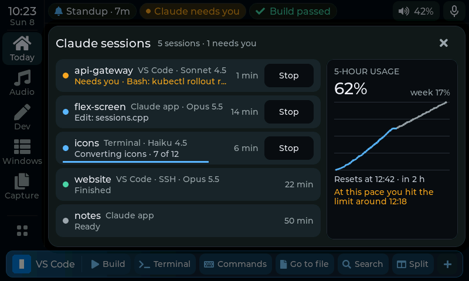

- Every Claude session on the PC in one list: the Claude app, each VS Code window,
  terminals and Remote-SSH. The ones that need you first, then those at work, then the
  rest. Each row says where it runs and its model, what it's doing (or waiting on), how
  long it's been at it, and a long job's progress.
- Tap a row to bring up its window. **Stop**, held, ends that session's turn before its
  next step (a tap only says *Hold*). It works the same in the app, VS Code, a terminal or
  on a server: before each tool call Claude checks with the companion, about 70 ms.
- Beside it, the plan's 5-hour usage: the figure, the week's, a chart of the window so far
  with the recent pace carried ahead, when it resets, and "At this pace you hit the limit
  around 21:40" (or that it lasts until the reset).
- The status line's Claude pill and the Dev page's Claude banner open it.

## Claude approvals (on every page)

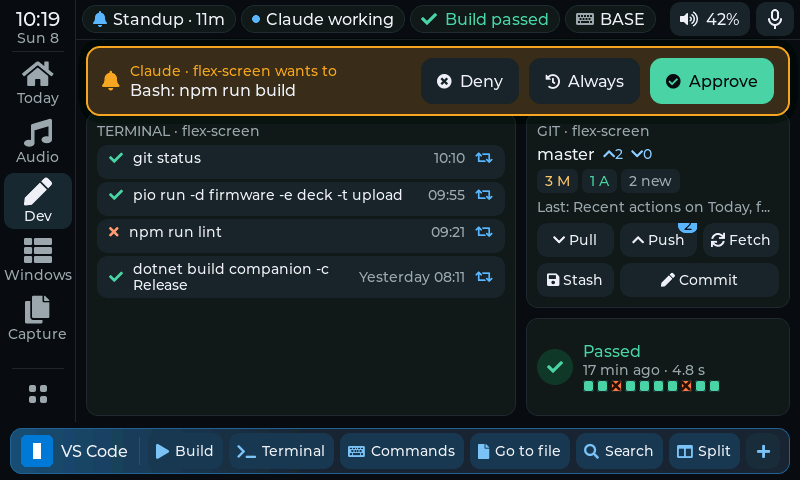

- When Claude Code asks for permission (in the Claude app, VS Code or a terminal), a banner
  under the status line shows what it wants to run, with **Approve**, **Always** (Claude's
  own "don't ask again" rule, when it offers one) and **Deny**. Claude's prompt on the PC
  shows as usual; whichever you answer first wins.
- Claude's own questions (its question box) show on the deck with their options: tap one,
  or for a question that takes several, tap them and **Done**. Several questions asked
  together come one at a time ("2 of 3"). The X leaves it to the PC. Again, whichever you
  answer first wins.
- Turn both off from the tray icon: **Approve Claude from the deck**.
- The status line's Claude pill says **needs you** for a question too, and a plan waiting
  for approval or a turn that ends asking you something in the Claude app (those you
  answer at the PC). A banner or card goes as soon as you answer at the PC instead.

## Claude talks to the deck (on every page)

<p>
  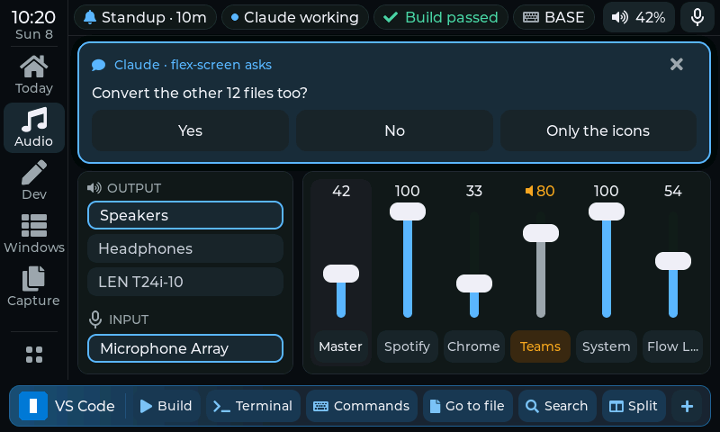
  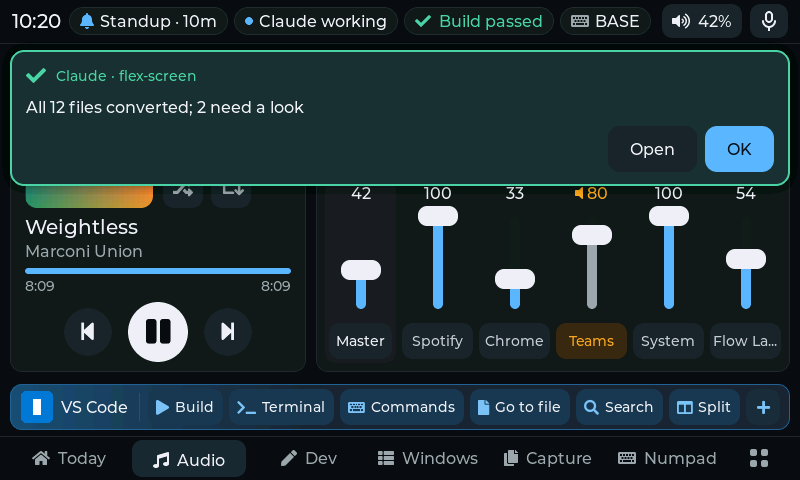
</p>

- Claude Code gets three tools for the deck (an MCP server in the companion, registered
  for every project when the hooks are installed, and allowed without a prompt):
  - **deck_ask**: a question with 2-4 buttons; Claude waits for your tap (up to 15
    minutes, or as long as it asks, at most 50) and carries on with the answer. Handy for
    long jobs you leave running: ask it to "ask me on the deck" before anything risky.
  - **deck_notify**: a note that stays until you tap **OK** (or write to that session
    again); **Open** brings up its window.
  - **deck_progress**: "3 of 12 · Converting icons" on the Dev page's Claude banner, with
    a bar, and **Claude 3/12** in the status line, until the job or the turn ends.
- Claude decides when to use them; it's told they're for when you may be away from the
  keyboard, not for the ordinary chat. Sessions on a Remote-SSH server get them through
  the same tunnel as the hooks.

## Scripts talk to the deck (flexctl)

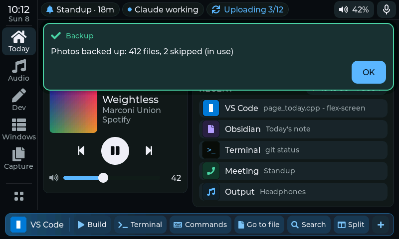

- The same three things for any script, scheduled task or build step, with the `flexctl`
  command the install puts on your PATH:

  ```powershell
  flexctl notify "Backup done: 412 files" -level done -from Backup
  flexctl ask "Deploy to production?" Yes No -from Deploy     # prints the button tapped
  flexctl progress 3 12 "Uploading" -from Backup
  flexctl progress -clear
  ```

  - **notify** leaves a note that stays until you tap **OK** (or 30 minutes), under the
    name the script gave (`-from`, "Script" if none), with the level's color and icon
    (`info`, `done`, `warning`, `error`).
  - **ask** shows 2-4 buttons and waits for a tap (15 minutes, or `-wait` minutes), then
    prints the button's label. The exit code says how it went: 0 an answer, 1 dismissed
    on the deck, 2 no answer in time, 3 the companion or the deck isn't there, 4 wrong
    arguments. A script that stops waiting (Ctrl+C) takes its question off the deck.
  - **progress** shows "Uploading 3/12" in the status line, in the build pill's place,
    until done reaches total, `-clear`, or 30 minutes without a word (a script that died).
- On a Remote-SSH server the server's hooks script also writes `~/.local/bin/flexctl`
  (Python, through the same tunnel), which takes the same commands with `--level`,
  `--from`, `--wait` and `--clear`, and names the server unless `--from` says otherwise.
- Underneath it's three local endpoints, `POST http://localhost:48151/api/notify`, `/api/ask`
  and `/api/progress`, taking JSON (see [protocol/v0.md](../protocol/v0.md)); anything on the PC
  that can send a request can use them, and no web page can.

## Context bar (on every page)

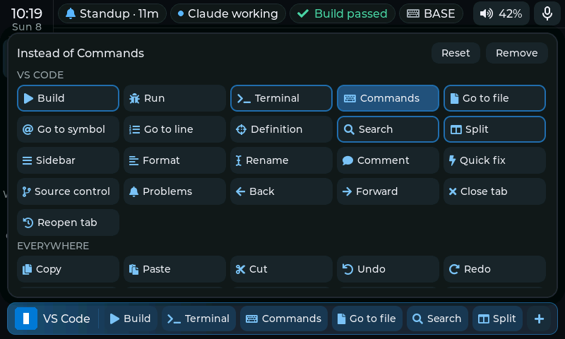

- A strip along the bottom, the screen's whole width, with keys for the app in front on
  the PC, in that app's color. The keys each app starts with (a long press shows the rest of its list):
  - **VS Code:** Go to file, Go to symbol, Terminal, Search, Approve, Model. Its list also
    has Build, Debug and stepping, Definition, Rename, Format, Comment, Quick fix, Source
    control, and Claude's own: open Claude, New Claude chat, Accept or Reject changes,
    Mention file.
  - **Claude Code in VS Code:** while Claude's chat tab is the one in front, the bar turns
    into Claude's, in Claude's color: Approve, Deny, Model, Effort, Usage, New chat (its
    list also has Stop, Another chat, Reopen chat and VS Code's keys). This needs Claude in
    an editor tab (Claude's "Open in New Tab", its default), not the side bar, which VS Code
    doesn't let the deck's extension see. Local and Remote-SSH windows alike.
  - **Claude app:** Approve, Deny, Model, Effort, Usage, New chat.
  - **Chrome and Edge:** Back, Reload, Prev tab, Next tab, New tab, Reopen, Find. On
    **Gmail**, **YouTube**, **Google Calendar**, **Jira** and **GitHub** the bar has that
    site's keys (Compose, Reply, Archive…; Play, Back 10 s, Captions…; Today, Week, New
    event…; Create, Comment, Assign to me…; Issues, Pull requests, Find file…), and on your
    own sites the keys you give them (see [Sites](#sites-in-the-browser)). Gmail's need its
    keyboard shortcuts turned on in Gmail's settings.
  - **Installed web apps** (Chrome's or Edge's *Install as app*: Gmail, Outlook, YouTube
    Music…) show on the deck under their own name and icon, and get their site's keys.
  - **Windows Terminal:** Prev cmd, New tab, Prev tab, Next tab, Split right, Split down;
    its list also has Clear, History, keys that type `git status`, `git pull` or `claude`,
    and Claude's keys.
  - **Explorer:** Up, New folder, Rename, Copy path, **Terminal here**, **VS Code here** (and
    Claude here, Copy folder, Preview pane, views…).
  - **Obsidian:** Daily note, Search, Quick open, Commands, Back, Graph.
  - **Spotify:** Previous, Play/pause, Next, Like, Shuffle, Search.
  - **Teams:** Activity, Chat, Calendar, New chat, Search; during a meeting Mute, Camera,
    Raise hand, Like, Share, Leave (and the other reactions).
  - **Discord:** Switch, Prev channel, Next channel, Unread, Mute, Deafen.
  - **Any other app:** Copy, Paste, Undo, Save, Find, Close, in the color of its icon.
- A key presses its shortcut in that app's window. If the desktop or a menu took the front
  meanwhile, the window comes back first. In VS Code, keys run VS Code's own commands
  through the flex-screen extension, so your own keybindings don't matter.
- **Claude's keys** work wherever Claude Code runs, the app, VS Code or a terminal:
  **Approve** and **Deny** answer the newest request; **Model** and **Effort** show the
  session's (the model from Claude's last reply in the session) and open a list to change
  them (typed as `/model` or `/effort` into its prompt); **Usage** shows the 5-hour
  window's use ("5h 42%") and types `/usage` there. The percentage comes from the usage
  endpoint `/usage` itself reads, with the sign-in token Claude Code keeps in
  `%USERPROFILE%\.claude\.credentials.json`. When that token has expired (the Claude app
  signs in on its own and leaves the file alone), the companion runs Claude Code's own
  `claude -p /usage` in the background, at most every 20 minutes, which reads the figure
  and renews the token. That renewal only works while Claude Code's sign-in lasts; when
  it ends the key says **Sign in**, and tapping it opens `claude auth login` in a console
  window (it goes on in the browser); the figure comes back within a couple of minutes.
  The Claude app's own sign-in is separate and can't be read. For Claude Code on a
  Remote-SSH server, the server's hooks run its `/usage` there and send the figure (see
  [install/README.txt](../install/README.txt)).
- **Hold the app's name** at the bar's left to keep the bar on that app: reading docs in
  Chrome while VS Code's keys stay, say. The name turns amber with a lock on its icon, other
  apps coming to the front leave the bar as it is, and a key brings the locked app's window
  back to the front before it presses. Hold it again (or close that window) and the bar
  follows the app in front again. A tap on the name still opens its page.
- **Long-press a key** to pick another action for its place from that app's list (VS Code
  also has Go to symbol, Go to line, Run, Rename, Format, Comment, Source control…; every
  app gets an "Everywhere" list: Snap left, Screenshot, Lock PC…). One already on the bar
  swaps places with it, which is how you reorder. **Remove** takes the key off, **Reset**
  puts the app's defaults back, and **+** at the end adds a key. Each app's arrangement is
  kept by the companion on that PC.
- **The shortcuts you press there come first** in that list, under *You press these often*:
  the companion counts the key combinations you press on the PC's own keyboards in each app
  (Ctrl, Alt and Win combinations and the F-keys, never typing, and never keys a program
  presses), and offers the ones pressed five times or more that aren't on the bar yet, up to
  five. One the app's list has an action for is that action; any other is a key of its own,
  named by its keys ("Ctrl+Shift+L"), that presses them. Only the counts are kept, per app, in
  `%LOCALAPPDATA%\flex-screen\shortcut-counts.json`; one not pressed for 30 days is dropped.
  `"countShortcuts": false` in the settings turns it off (from the companion's next start).
- Add your own actions to an app's list in the profile's `contextBar` (see [Settings](settings.md#settings)).

## Sites in the browser
Which site a browser window shows is told by its tab's title (*… - Gmail*, *… · GitHub*),
or, with the **flex-screen browser extension**, by its address, which works on every page
whatever its title says (a Jira issue, a GitHub file). The extension comes with the
companion: once per browser, open `chrome://extensions` (or `edge://extensions`), turn on
**Developer mode**, **Load unpacked**, and pick
`%LOCALAPPDATA%\Programs\flex-screen\chrome-ext`. It sends the companion only the address
and title of the tab in front, to `localhost`, never for an incognito tab; the companion
keeps them in memory and tells the deck only which site it is. Updates come with the
companion's, picked up when the browser restarts.

A site's keys are data: the built-in ones are
[companion/Integrations/Browser/sites.json](../companion/Integrations/Browser/sites.json), and
the profile's `"sites"` add your own (or replace a built-in one by its id). A key is written
as for `contextBar`:

```jsonc
"sites": [
  { "id": "notion", "name": "Notion", "color": "#FFFFFF",
    "match": { "url": ["www.notion.so/*"], "title": ["* | Notion"], "app": ["Notion"] },  // * is anything
    "keys": [
      { "id": "notion-search", "name": "Search", "glyph": "search", "keys": "Ctrl+P" },
      { "name": "New page", "glyph": "plus", "keys": "Ctrl+N" }
    ],
    "default": ["notion-search"] }   // the bar until you arrange it on the deck
]
```

`url` is the address without `https://` (host and path), `title` the tab's title, `app` an
installed web app's name. The address is tried first, then the app, then the title, and
the first site that matches wins (yours before the built-in ones).

## Shortcuts (on every page)

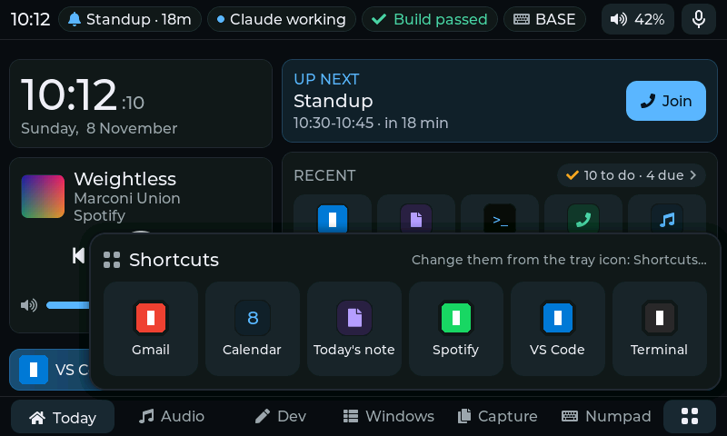

- A launcher button at the foot of the rail opens a panel of up to 12 tiles:
  apps, links, deck actions and key combinations, each with its real icon (an app's own,
  a site's) or a symbol. Tap one to run it; tap anywhere else to close.
- An app that's already open comes to the front instead of starting again. Apps are
  found by their Start menu name, Store apps (Spotify, Terminal) included.
- Out of the box: Gmail, Calendar, Today's note, Spotify, VS Code and Terminal. Change
  them per PC from the tray icon's **Shortcuts…** (see [Settings](settings.md#settings)).
- Tiles for the PC itself: **Volume up** and **Volume down** step it as the keyboard's
  volume keys do, and keep going while held (the panel stays open for more); **Mute** and
  the microphone's tile light up amber while muted, like the status line; **Screens off**
  puts the monitors to sleep (the mouse wakes them); **Task Manager** opens it, with its
  own icon. Add them as actions (`vol.up`, `vol.down`, `vol.mute`, `mic.mute`,
  `screens.off`, `taskmgr.open`).

## Today
- Big clock.
- Now playing: album art, title, artist and app, play/pause, next/previous, volume. The
  card takes on the color of the album's cover, as Audio's does.
- Up next: the next calendar event, from every calendar you put on the deck (see
  [Calendars](calendars.md)), with a **Join** button for Meet, Zoom or Teams links.
  Tap it for the whole day: today's events in order, those over dimmed above a line at
  the time now, the one going on picked out, **Join** on each with a meeting link, which
  calendar each is from, with that calendar's color down its edge, today's all-day events
  along the top, and tomorrow's below.
  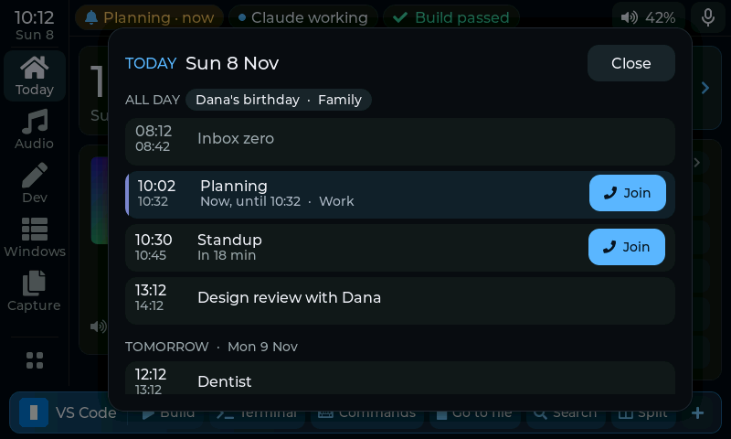
- Recent: the last five things you did from the deck, a row each: a window you brought up
  (with its app icon), a note opened, a command run, a meeting joined, Gmail, a Claude
  session, a sound output picked. Tap one to do it again; a window that has closed since
  brings up another window of its app, or starts the app. Most recent at the top; doing
  something already listed moves it there instead of adding it twice.
- How many tasks are open and how many are due today or overdue; tap it for Capture.

## Audio

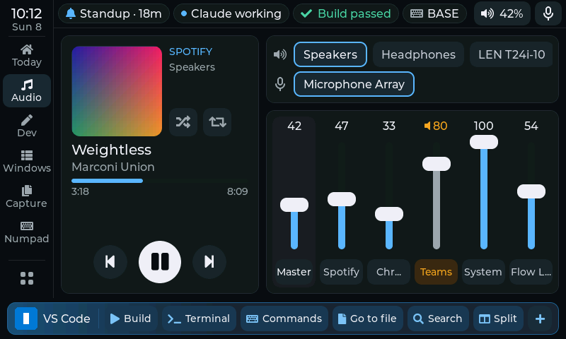

- Now playing across the top: the keys on the left (play/pause, next/previous, shuffle,
  repeat), the track and its progress in the middle, the album art on the right.
- Drag the progress bar to go to another part of the track (the time shows as you drag,
  and it goes there when you let go), or tap the bar to jump there. Only where the player
  allows it (Windows says which do); for the rest it stays a plain bar.
- In the cover's color: the card is tinted with the album's own color, and the progress bar,
  the player's name and the shuffle and repeat keys take it on. The companion picks it from
  the cover (the hue its vivid parts share most, made light enough to read); a grey or
  black-and-white cover keeps the theme's color.
- Output and input devices as lists down the left; a tap sets the Windows default device.
- Per-app mixer beside them: a fader for each app playing sound; tap the app's name under
  it to mute it (amber while muted). Teams, Discord and Zoom have a fader whenever they're
  open, even before they make a sound (Windows only gives an app a volume once it plays
  something): they start at the level set there, kept across restarts. Spotify comes
  first, then Teams.

## Dev

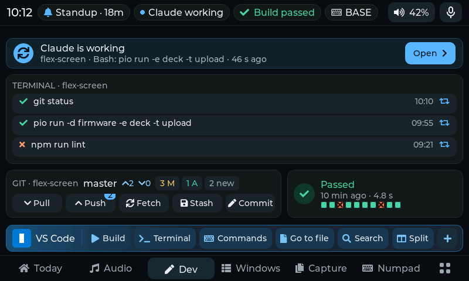

- Claude banner: what the current session is doing, with an **Open** button; tap the
  banner for the session board.
- Terminal, down the left: the last few commands run in VS Code's terminal, each in full
  (a long one wraps), with ✓/✕ and the time it started. Tap one to run it again in the
  terminal it came from. History is kept per workspace, so it survives restarts.
- Git for VS Code's active repo, on the right: branch, ahead/behind, changed files, the
  last commit; fetch, pull, push, stash, and **Commit…** to open VS Code's Source Control.
- Build card under it: the last 10 build runs and their results.

## Windows

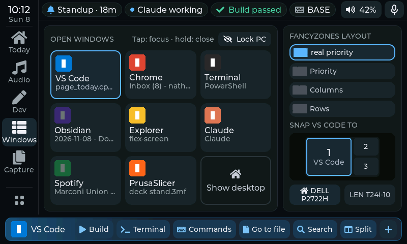

- The 8 most recently used windows with their icons, in taskbar order. Tap to focus (tap
  again to minimize); a minimized window keeps its tile, icon dimmed, and a tap brings it
  back. Hold to close the window, which takes its tile away at once.
- **Drag a tile to snap its window**: as soon as a tile moves under your finger the desktop
  map (below) comes up in the tiles' place: every monitor's FancyZones zones, each naming
  the app that fills it now, and above them a **Full screen** tile for each monitor. Where
  the window would go is drawn as it would be there, with its icon and name: the zone under
  your finger (in place of what's there now), or the whole monitor over its Full screen
  tile. Let go and it goes there, on whichever monitor (minimized windows too): snapped
  into the zone, or maximized on that monitor; the tiles come back. On a monitor without
  zones the window's middle goes where you let go, its size kept; off the monitors, or back
  in the zone it fills already, nothing moves. A swipe that starts on a tile drags the
  window, so swipe to another page from elsewhere on the page, or use the rail.
- Show desktop and Lock PC.
- **Map** (beside Lock PC) shows the desktop map instead of the tiles (**Tiles** goes back):
  your monitors as they're arranged, each open window drawn where it is on them, the one in
  front on top, with its icon and name when there's room. Tap a window to bring it up (or
  minimize the one in front, as a tile does). Drag one to move it: the FancyZones zones show
  while it's dragged, the one under your finger lit, and letting go snaps the window into
  it, on whichever monitor. On a monitor without zones it goes where you let go, its size
  kept. Let go off the monitors, or back in the zone it fills already, and nothing moves.
  Minimized windows stay on the tiles.
  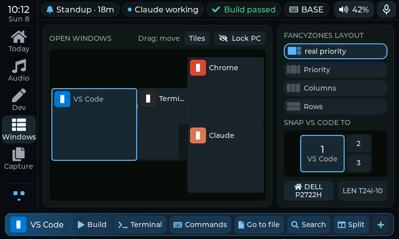
- FancyZones: switch each monitor's layout (Priority grid, Columns, Rows, Grid or your
  custom layouts), tap a zone on the map to snap the active window into it, tap it again
  to maximize. A monitor picker for multi-monitor setups.

## Capture

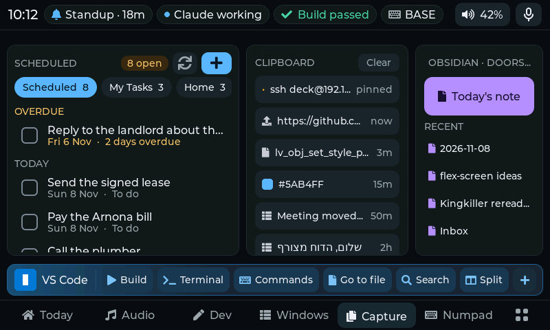

- Tasks (see below) on the left; the clipboard over Obsidian on the right.
- Clipboard history: your newest text copies plus pins. Tap to paste into the focused
  window, hold to pin, Clear; three show at a time, and the list scrolls. Copies that
  password managers mark as private are never recorded, and the history is stored
  encrypted for your Windows account.
- Obsidian: open today's daily note, or one of the four most recent notes, in a grid of
  two columns under it.

## Tasks (on Capture)

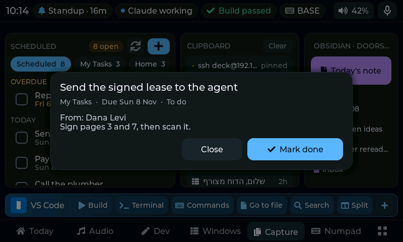

- Tasks from several places at once, each keeping where it came from: **Google Tasks**,
  **Microsoft To Do**, the open tasks of your latest **Obsidian** daily note, and the
  **Jira** and **GitHub** issues assigned to you (set up under the tray icon's **Task
  sources**; [docs/task-sources.md](task-sources.md) walks through each). A source not
  set up on a PC is left out, so the same companion suits home and work.
- Chips along the top with how many are open in each: **All tasks** (where it opens: every
  task of the lists you chose for the deck, dated ones first), **Scheduled** (every task
  with a due date, from any list, also one kept off the deck) and then each list you chose
  (the tray icon's **Task lists on the deck**; all of them until you untick some). Swipe
  the chips sideways for the ones past the card's edge. Grouped by when they're due:
  overdue, today, tomorrow, this week, later, no date. Under Scheduled a row is just the
  title, the due day and its status (to do, done, or how many days overdue); in a list it's
  the day and the first line of its notes, and under All tasks the list's name first. An
  issue's row shows its key, priority and status instead. Subtasks are indented.
- Tap a task to open it: its whole title, list, due day, status and notes, what its source
  says about it (a Jira issue's project, key, priority and status, below), **Open in …** (the
  issue's page, the note in Obsidian, the task on the web), **Mark done** and **Close**
  (or tap beside it).
  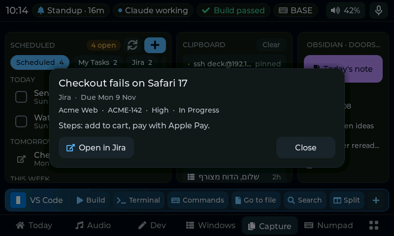
- Tap the box at a task's start to tick it off in its source straight away. It stays on
  the page, struck through, until midnight, so ticking it again undoes it. Jira and GitHub
  issues have no box: they're moved on in Jira or GitHub, not by a slip of the finger.
- **+** opens a form with an on-screen keyboard: the title, which list (the one on
  show to begin with; from All tasks, Scheduled or an issues list, the first list, due
  today from Scheduled) and when it's due (no date, today or tomorrow).
- No *Starred*: Google's Tasks API doesn't say which tasks are starred.
- The ↻ button reads every source again now; otherwise the companion reads them every 2
  minutes and right after every change from the deck.
- Another source is one class in the companion (`ITaskProvider`: read, tick, add), added
  to the list in `TrayApp`.

## Numpad

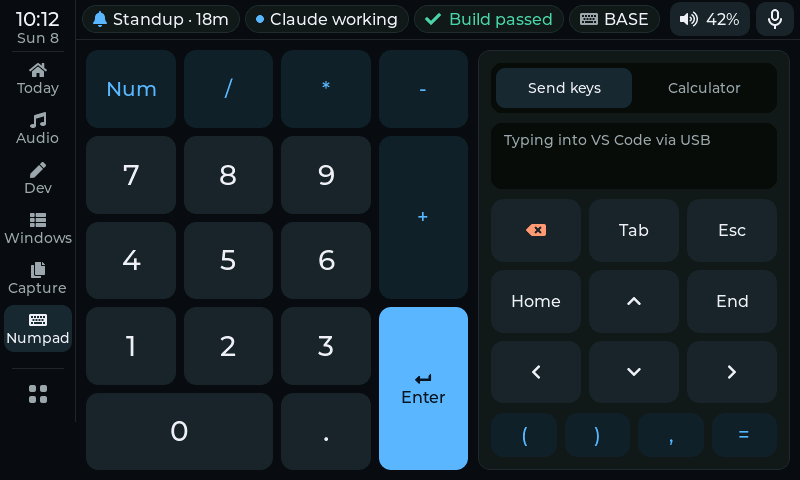

- Not a page: **Numpad** in the shortcuts panel's header (the launcher at the foot of the
  rail) pops it up over whatever page is on show, covering the context bar. Its X, or a
  tap beside it, closes it.
- A full USB keypad, with keys that repeat while held, editing keys, and `( ) , =`.
  Num Lock follows the PC's.
- Calculator mode: work it out on the deck, and Enter types the result into the PC.

## Calls

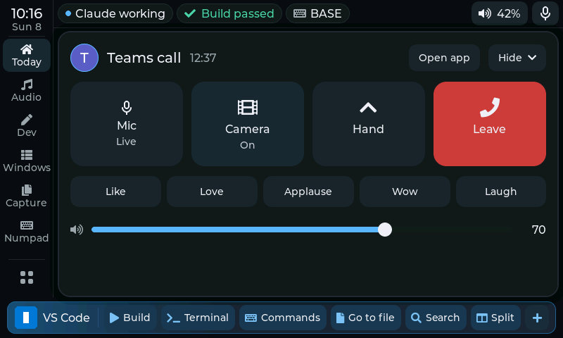

<p>
  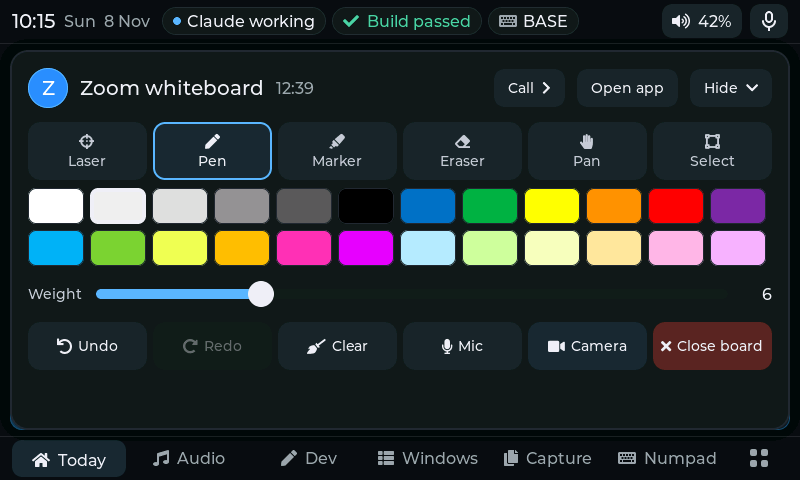
  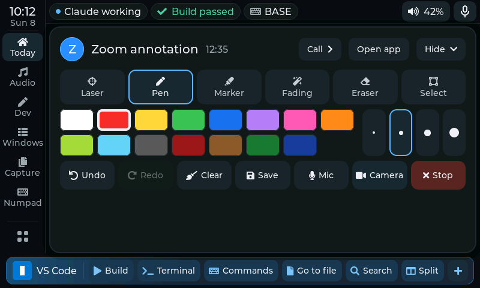
</p>

- When an app is using the microphone (Teams, Zoom, Discord, Webex, a browser), a call
  panel pops up with what that app allows: mute, camera, raise hand, reactions, leave,
  volume, and bring the call forward. Hide turns it into a status-bar pill.
- Teams through its local API (real mute, camera and hand state); Zoom through its own
  toolbar buttons (real mute and camera state, even while sharing); Discord's deafen
  through the mixer. A Zoom meeting counts as a call even when joined without audio.
- Zoom drawing: **Whiteboard** opens a new whiteboard, **Annotate** starts annotating the
  screen you're sharing. While either is open the panel turns into a tool panel:
  - Whiteboard: Laser, Pen, Marker, Eraser, Pan, Select. Each tool shows its own colors
    (the pen's 24, the marker's 6, the laser's 6) and the pen, marker and pixel eraser a
    weight slider; the eraser switches between whole stroke and pixel. Zoom hides the
    laser when the meeting window is narrow, and so does the deck.
  - Annotation: Laser (Zoom's spotlight, or its arrow), Pen, Marker, Fading pen, Eraser,
    Select, with Zoom's 15 colors and four line widths.
  - Both: Undo, Redo, Clear (hold), Save (annotation), Mic, Camera and Stop/Close.
    "Call" in its corner flips back to the call's controls and "Draw" returns.
- Meeting apps' context bar (Zoom, Teams, Discord): that app's next meeting on your
  calendar, told by its link (a zoom.us link for Zoom, a Teams link for Teams, a Discord
  invite or event for Discord; "12m · Standup", tap for Today's Up next), Join (that
  one), Mute and
  Camera (showing the call's state; Mute is Windows' mic outside a call), New meeting
  (Zoom's instant meeting, Teams' new-meeting form, Discord's Start call in the open DM)
  and Chat (Zoom's Team Chat, Teams' Chat; the meeting's chat during one). In a meeting
  Share and Leave join them. Discord has no camera key (Discord has no shortcut for it)
  and keeps Deafen. Zoom's bank also holds Participants, Reactions, Whiteboard, Annotate,
  Raise hand, Record, Full screen and quick reactions (hold a key to swap).

## Keyboard layer cheat sheet

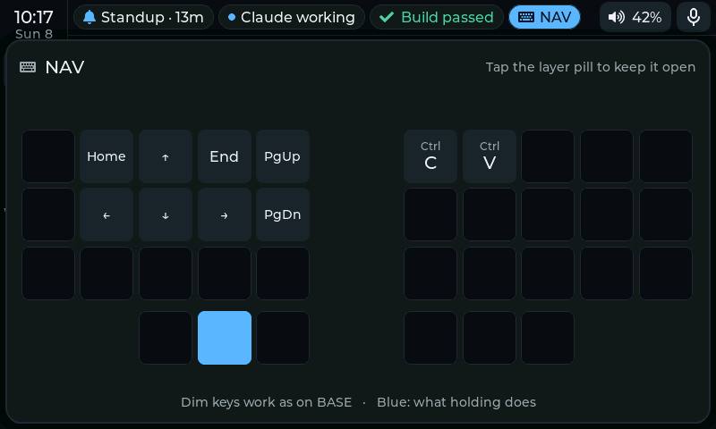

- Hold a layer key for ten seconds (`cheatSheetSeconds` in [Settings](settings.md#settings)) and the
  deck shows that layer laid out like your keyboard, read straight from the Vial keyboard's own layout and keymap. Letting go
  hides it; tapping the layer pill keeps it open.
- **Edit in Vial**, at its top right, opens Vial's web app ([vial.rocks](https://vial.rocks/))
  on the PC, to change the keymap there; the deck only shows it. Vial's web app needs
  Chrome or Edge.
- With more than one Vial keyboard plugged in, the pill and cheat sheet follow the one
  you last typed on. A keyboard Vial has locked can't report its layer: unlock it once
  in the Vial app (Security > Unlock) and it stays unlocked until it's unplugged.

## The deck itself
- Holds show a ring: wherever a hold does something (Stop on the session board, closing a
  window, Zoom's Clear, pinning a clip, a context bar key's list, locking the bar, the
  clock's diagnostics), a ring fills round your finger and is full just as the hold takes
  effect. Lifting early or sliding away cancels it, and a tap never shows it. Red where the
  hold ends something, amber for the lock.
- Idle: a dim clock after 10 minutes without input on the deck or the PC, screen off
  after 30 (both adjustable). A locked PC shows the clock straight away.
- Edge glow: a thin colored frame around the whole screen blinks twice and fades away
  when something happens, there to be caught out of the corner of your eye, over any page
  and the dim clock too. **Amber** when Claude comes to need you (a session waiting, an
  approval or a question), **red** when a build fails, **blue** when a call starts. It
  doesn't stay lit, and doesn't blink again for something that's still going on.
- Diagnostics (hold the clock at the top of the rail): the firmware version and why the deck last
  restarted, how long it's been up, free memory (internal RAM with its low point and
  largest free block, and PSRAM), the frame rate (now and the busiest second of the last
  minute, with how long a frame takes to draw), and the link to the PC: how long it's been
  up or down, lines taken in, and its errors: garbled lines, lines too long, bytes lost to
  a full buffer, bad image parts and drops, with the last error and when. Counts run from
  the deck's start. It works offline too.
- Demo (the **Demo** button in the diagnostics): about a minute and a half of the deck showing
  what it does, by itself, for showing it to people. A made-up day goes through the pages
  and the overlays one at a time, each with a caption, and a ring shows where it taps: Today,
  the whole day from Up next, Audio's faders moving, Dev with Claude at work, an approval and
  a question from Claude, the session board, windows tapped to the front with the context bar
  following each, Capture, a Teams call, drawing on a shared screen in Zoom, the shortcuts and
  the Numpad, and the keyboard's layers. It sends the PC nothing and works without one; a
  touch ends it, and the deck comes back as it was, with whatever the PC sent meanwhile.
- Five color themes, Base, Vibrant, Ember (warm, orange), Violet and Pastel (soft pink, mint
  and lavender on a dusky plum-grey), from the tray menu.
- One deck, several PCs: it shows whichever PC it's plugged into. The PCs can share a
  profile (a synced folder), while each keeps its own sign-ins, vault and clipboard.

## Updates

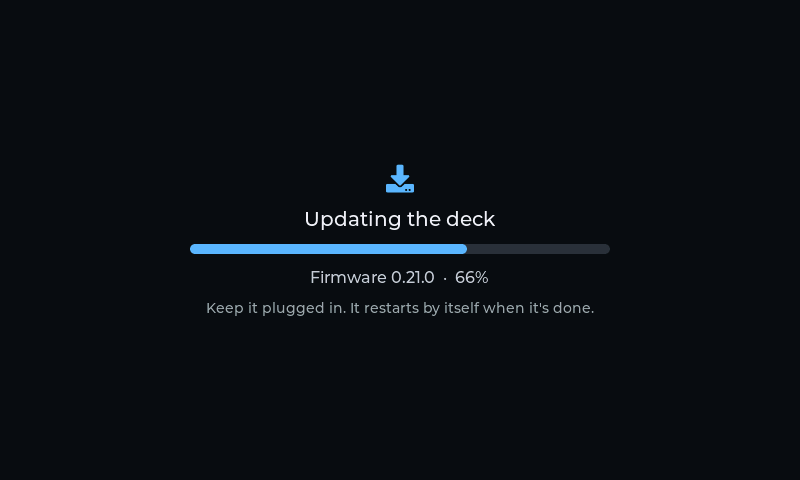

- **The deck's firmware comes with the companion.** When the deck runs an older one (it
  was last updated on another PC, say), the tray icon says so and the deck shows
  "Firmware 0.21.0 is ready · tap to update". Tap it, or pick **Update the deck's
  firmware** in the tray menu. It goes over the same USB cable in about half a minute,
  with the progress on the deck; once it's all in, the screen goes dark for a few seconds
  while the deck writes it, and comes back on the new firmware. No PlatformIO needed, so
  any PC with the companion can do it.
- Nothing changes on the deck until the whole image has arrived and checked out (its MD5,
  checksum and SHA-256); an update that stops on the way (unplugged, the PC asleep) leaves
  the deck on the firmware it had. A new firmware also stays on trial until it has heard
  from the PC: one that can't start, or can't reach the PC, is undone by the next restart
  (unplug the deck and plug it back in). If the deck doesn't come back at all, the tray
  says how to flash it through its bootloader (see [Firmware](../README.md#firmware)).
- **The companion updates itself** from this repo's GitHub releases. It looks a minute
  after it starts and every 6 hours (**Check for updates** in the tray menu looks now).
  When there's a newer release, **Update flex-screen to 0.21.0** downloads the release's
  `flex-screen.zip`, checks it against the SHA-256 GitHub gives for it, and installs it as
  `install.cmd` does (the companion, the VS Code extension and the hooks). The companion
  restarts by itself, says it's updated, and then offers the deck its new firmware.
- The deck running newer firmware than the companion knows (it came from a PC with a newer
  kit) makes the companion look for an update straight away.
